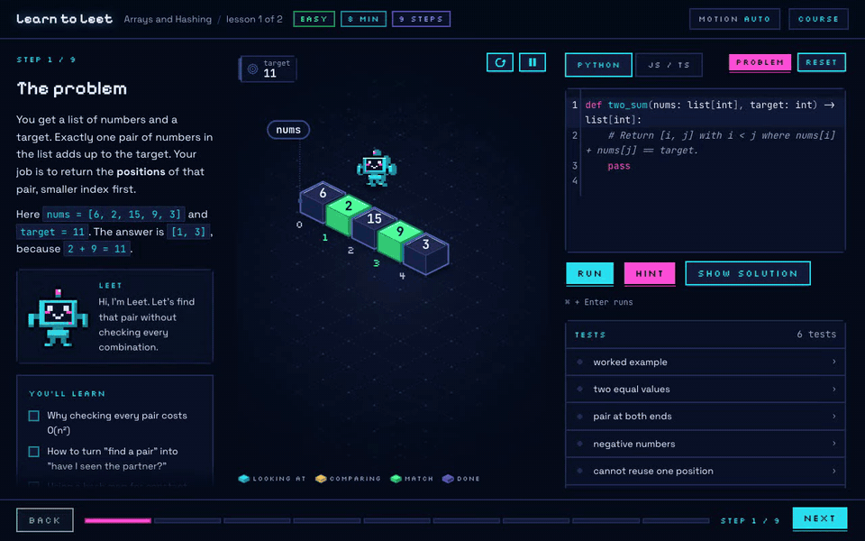
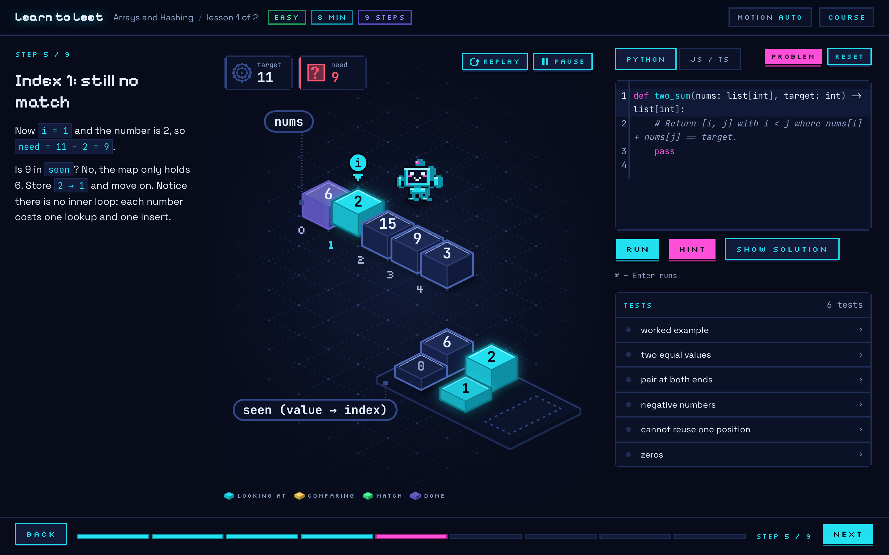
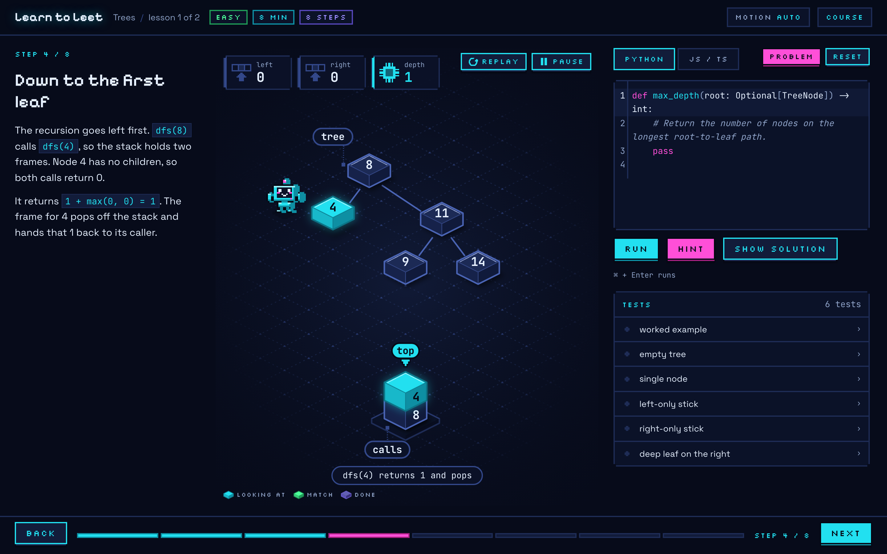
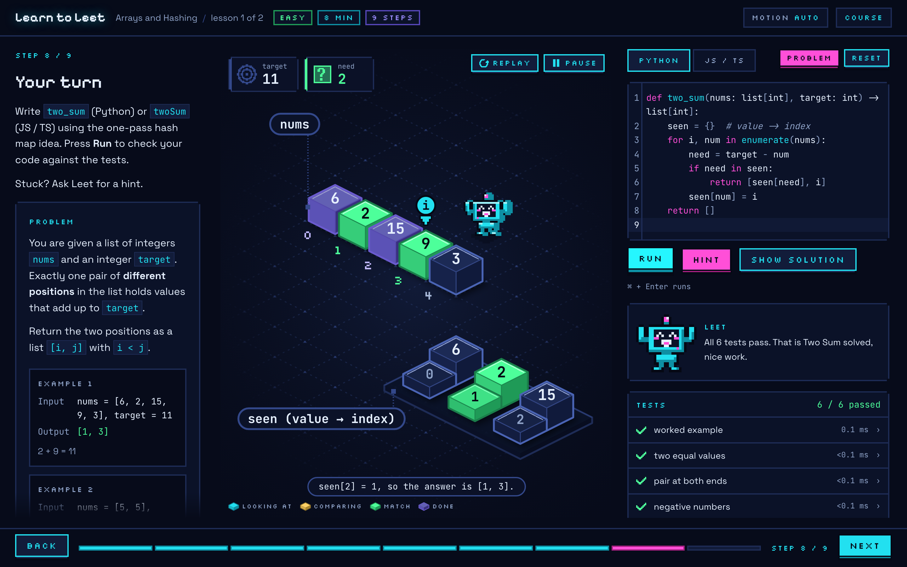
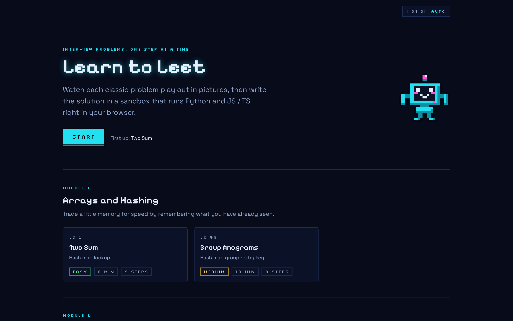
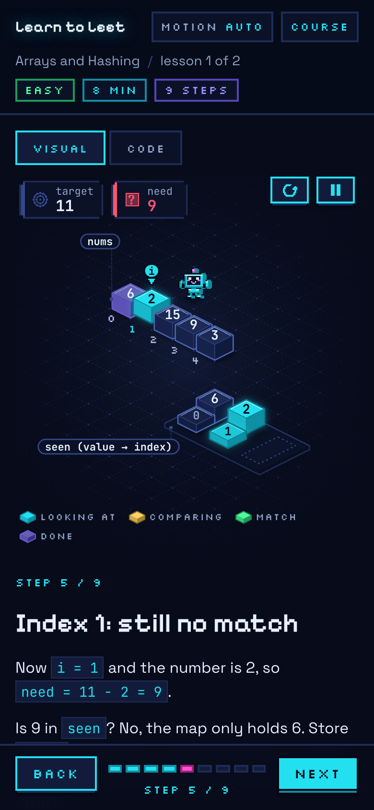

# Learn to Leet

Live site: TBD

Learn to Leet teaches classic LeetCode-style problems in short illustrated steps. Each lesson is a walkthrough with an animated isometric visual that changes at every step, followed by a challenge you solve in an in-browser sandbox, in Python or JS / TS, against real test cases. Everything runs client side, so there is no backend and no sign-up. Problem statements are written from scratch.

## Screenshots

| | |
|---|---|
|  |  |
|  |  |

On a phone the visual and the code get their own tabs:



## Features

- 15 lessons in 8 modules, each 8 or 9 steps with prev/next, a progress bar and a recap.
- An animated isometric visual per step: arrays with pointers, hash maps, stacks, queues, linked lists, trees, graphs and grids.
- A code sandbox in every lesson: editor, Run button, per-test pass or fail, hints and a reference solution.
- Python (Pyodide) and JS / TS (Web Worker). Code runs off the main thread, so the page never freezes.
- Pixel art throughout, with a mascot called Leet.
- Phone layout, keyboard navigation and a reduced-motion mode.

## Lessons

1. **Arrays and Hashing**: Two Sum, Group Anagrams
2. **Two Pointers and Sliding Window**: Valid Palindrome, Container With Most Water, Longest Substring Without Repeats
3. **Stacks**: Valid Parentheses, Daily Temperatures
4. **Binary Search**: Binary Search
5. **Linked Lists**: Reverse Linked List, Middle of the Linked List
6. **Trees**: Maximum Depth of Binary Tree, Binary Tree Level Order Traversal
7. **Graphs and Grids**: Number of Islands, Course Schedule
8. **Dynamic Programming**: Climbing Stairs

## How it works

- **Data-driven lessons.** One TypeScript data file per lesson in `src/content/lessons/` holds the steps, the visual state of each step, the problem statement, starter code, reference solutions in both languages and the tests. Adding a lesson is content work, not component work.
- **Isometric SVG engine.** `src/visual/` turns each step's scene description into an animated isometric SVG scene. The same structures (array, hash map, stack, queue, linked list, tree, graph, grid) are reused by every lesson.
- **In-browser runners.** Python runs through Pyodide in a worker. JS / TS is transpiled with Sucrase and run in another worker. Both go through the same test harness and comparison rules.
- **No backend.** The site is static. Progress and code drafts are kept in `localStorage`.

## Add a lesson

1. Create `src/content/lessons/<slug>.ts`. Copy `two-sum.ts` as a template and see `src/content/schema.ts` for the types.
2. Register the slug in a module in `src/content/modules.ts`.
3. Run `npm run check-content <slug>`. It validates the schema and copy rules, fits every scene in bounds, and runs the reference solutions in both languages, checking that the starters fail.

## Local setup

Requires Node 22.12 or later.

```sh
npm install
npm run dev
```

Other commands:

```sh
npm run typecheck        # tsc --noEmit
npm test                 # unit tests (vitest)
npm run check-content    # validate every lesson (or pass a slug)
npm run e2e              # Playwright end-to-end tests (builds and serves the site)
npm run build            # typecheck and production build
```

## Tech stack

Vite, React 19, TypeScript, Tailwind CSS 4, React Router, Zustand, Motion, CodeMirror 6, Pyodide, Sucrase, Vitest and Playwright. Fonts: Pixelify Sans, Silkscreen, Space Grotesk and JetBrains Mono via Fontsource.

## Credits

Format inspired by [Designed to Scale](https://designed-to-scale.vercel.app) by @DilumSanjaya

## Licence

[MIT](LICENSE)
